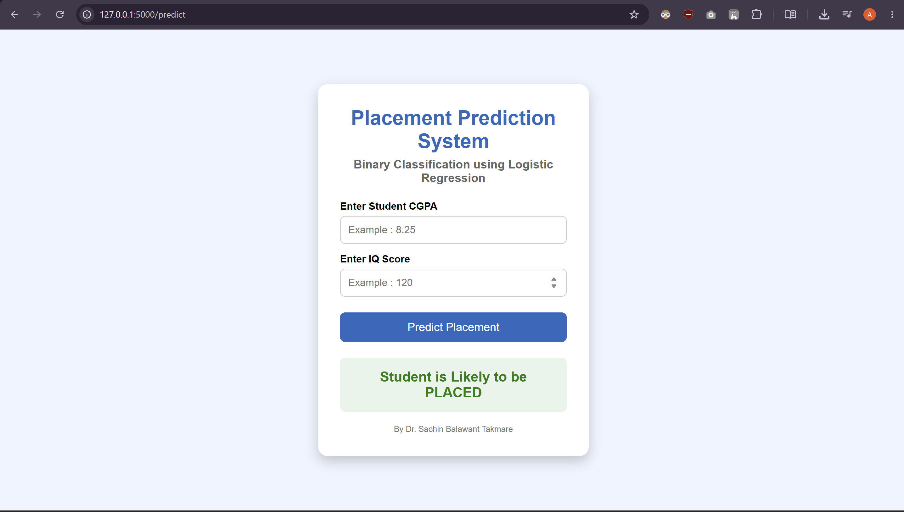
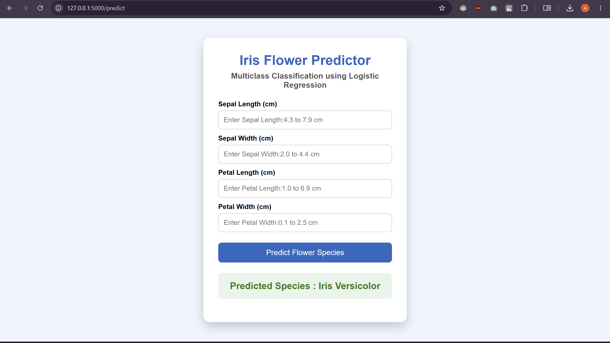
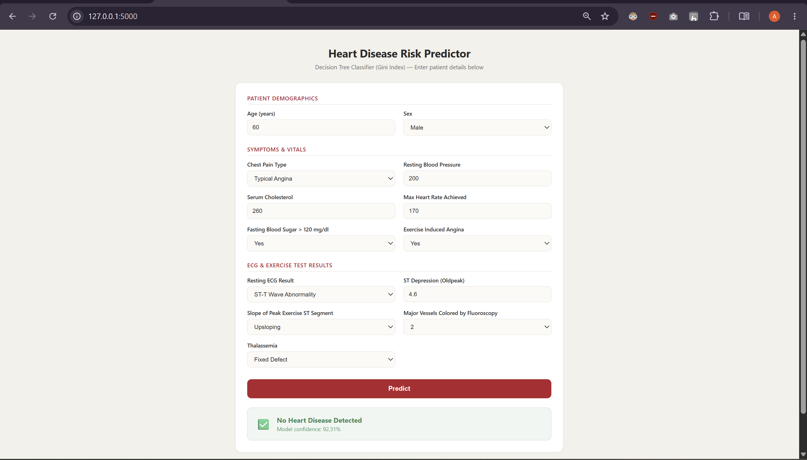
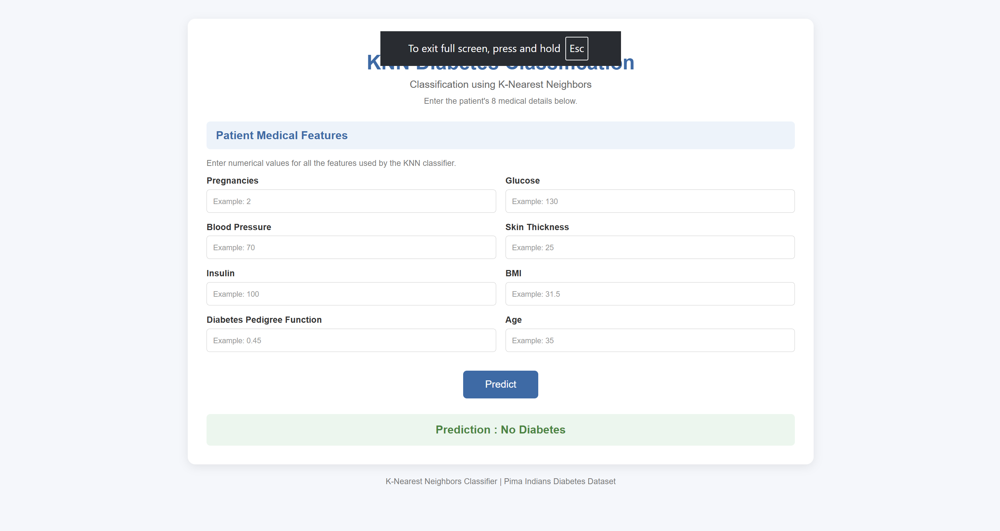
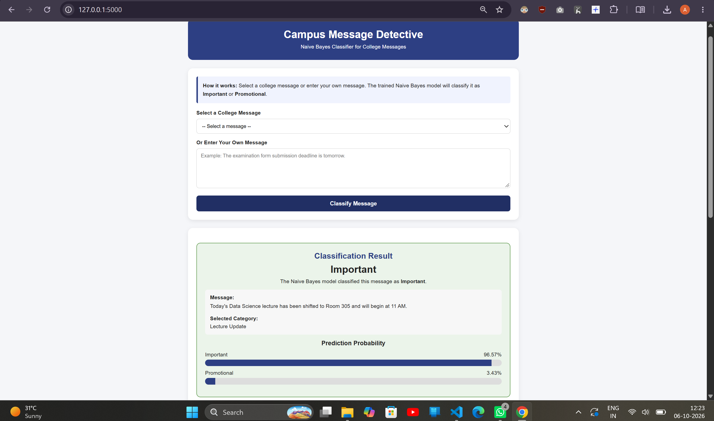
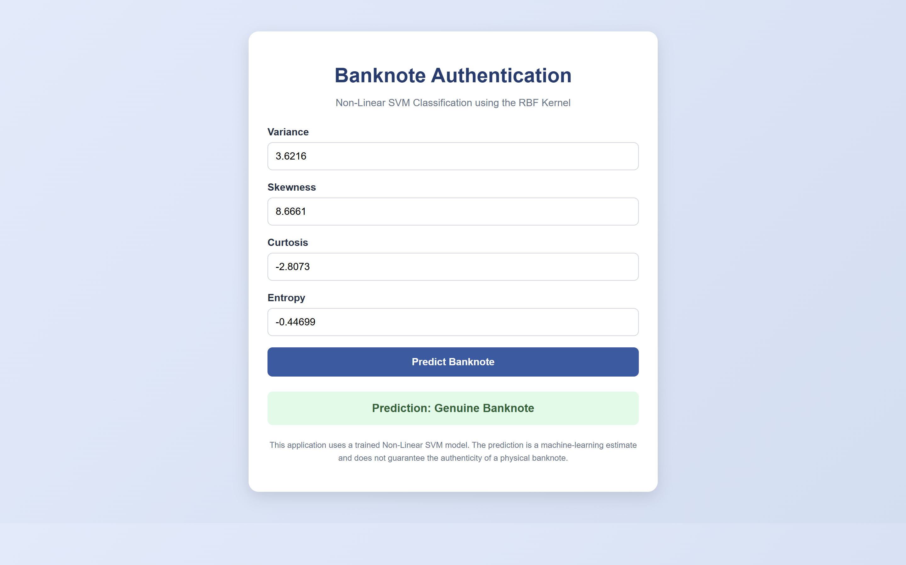

# 1.Python-Libraries

Complete Python Library Google Colab Notebooks.

---

## Libraries Included

-  NumPy
-  Pandas
-  Matplotlib
-  Seaborn
-  Scikit-learn
-  PyTorch
-  TensorFlow
-  Keras

---

## Open in Google Colab

Simply open any notebook and click **Open in Colab** to run it online.

Happy Learning! 


# Dataset

This folder contains essential concepts of data preprocessing, exploratory data analysis (EDA), feature engineering, visualization, handling missing values, encoding, feature scaling, and dataset cleaning using Python.

Also it Contains Mini Assisgnment

<p align="center">
  
</p>

Happy Learning! 


# 2. Simple Linear Regression

This project implements **Simple Linear Regression** using Python and Machine Learning.

### Technologies

* Python
* Pandas
* NumPy
* Scikit-learn
* Flask

### How It Works

The model learns the relationship between one input feature and the output value. After training, it can predict the output for new input data.

### Project Overview

This project includes model training, prediction, and a simple Flask web application to use the trained model.

### Output :-
.png)

Happy Learning! 


# 3. Multiple Linear Regression

This project implements **Multiple Linear Regression** using Python and Machine Learning.

### Technologies

* Python
* Pandas
* NumPy
* Scikit-learn
* Flask

### How It Works

The model learns the relationship between multiple input features and the output value. After training, it can predict the output for new input data.

### Project Overview

This project includes data processing, model training, prediction, and a simple Flask web application to use the trained model.

### Output :-
.png)

Happy Learning! 


# 4. Logistic Regression for Binary Classification

This project implements **Logistic Regression** for solving a binary classification problem using Python and Machine Learning.

### Technologies

* Python
* Pandas
* NumPy
* Scikit-learn
* Flask

### How It Works

The model learns from the given dataset and predicts one of two possible classes. Logistic Regression is used to calculate the probability of an input belonging to a particular class.

### Project Overview

This project includes data preprocessing, model training, prediction, and a simple Flask web application for making predictions.

### Output :-



Happy Learning!


# 5. Multiclass Classification using Logistic Regression

### About
This Project demonstrates **Multiclass Classification using Logistic Regression** to classify data into multiple categories. It uses input features to predict the appropriate class for a given data point.

### Objective
To implement Logistic Regression for multiclass classification and predict the class of new data.

### Dataset
A dataset with multiple input features and **three or more target classes** is used for classification. The dataset is explored and divided into features and target values before training the model.

### Model
**Algorithm:** Logistic Regression  
**Type:** Multiclass Classification

The model is trained using the training data and then used to predict the classes of unseen data.

### Evaluation
The performance of the trained model is evaluated using:
- Accuracy Score
- Classification Report

### Prediction
The trained model can be used to predict the class of new input data based on the given features.

### Libraries
- Python
- Pandas
- NumPy
- Matplotlib
- Scikit-learn

### Output :-



Happy Learning!


# 6.Decision Tree Classifier

## About
This experiment demonstrates **Decision Tree Classification** to classify data into different categories using a tree-based model.

## Objective
To build and train a Decision Tree Classifier and use it to predict the class of new data.

## Model
**Algorithm:** Decision Tree Classifier  
**Type:** Classification

## Evaluation
- Accuracy Score
- Classification Report
- Confusion Matrix

## Output
The output of the Decision Tree Classifier is shown below:


## Libraries
- Python
- Pandas
- NumPy
- Matplotlib
- Scikit-learn



Happy Learning!

# 7.KNN Classifier

## About
This experiment demonstrates the implementation of the K-Nearest Neighbors (KNN) classification algorithm on two different datasets: Diabetes and Breast Cancer.

KNN Workflow

- Load and Inspect the Dataset
- Data Preprocessing
- Explore the Data
- Split and Scale the Data
- Tune the K Value
- Train and Evaluate the Model
- Make Predictions


## 1. Breast Cancer Dataset
The KNN classifier is used to predict whether a breast tumor is malignant or benign based on diagnostic measurements.

### Output :-


## 2. Diabetes Dataset
The KNN classifier predicts whether a patient has diabetes or not based on diagnostic and medical measurements.


### Output :-



Happy Learning!


# 8.Naive Bayes Classifier

## About
Naive Bayes is a supervised machine learning algorithm based on Bayes' theorem. It is commonly used for text classification because it is simple, fast, and effective for handling text data.


## Project

Campus Message Detective is a machine learning project that automatically classifies college messages based on their content.

The system classifies messages into two categories:

- 📚 Important
- 🛍️ Promotional

## Technologies

- Python
- Pandas
- Scikit-learn
- Naive Bayes
- Flask
- HTML/CSS

## Run

```bash
pip install flask pandas scikit-learn joblib
python app.py
```

## Output :-


Happy Learning!


# 9.Linear SVM

## About :-

Linear Support Vector Machine (SVM) is a supervised machine learning algorithm used for classification. It finds the best separating hyperplane between different classes by maximizing the margin between them.

## Project :-

### Counterfeit Banknote Detection 

Develop a Linear Support Vector Machine (SVM) classification model to classify banknotes as genuine or counterfeit and deploy it as a Flask web application using HTML.

## Technologies Used :-
- Python
- Pandas, NumPy
- Scikit-learn
- Flask and HTML/CSS
- Google Colab

## Dataset :-

Banknote Authentication dataset containing four features: variance, skewness, curtosis, and entropy.

## Implementation :-
1. Load and explore the dataset.
2. Preprocess the data and split it into training and testing sets.
3. Train a Linear SVM model.
4. Evaluate the model using accuracy and a confusion matrix.
5. Save the trained model and integrate it with Flask.
6. Predict banknote authenticity through a web interface.

### Run the Application :-

```bash
pip install flask pandas scikit-learn joblib
python app.py
```
Open ```http://127.0.0.1:5000``` in your browser.

## Output :-


Happy Learning!


# 10.Non-Linear SVM

## About :- 

Non-Linear Support Vector Machine (SVM) is a supervised machine learning algorithm that can classify data using non-linear decision boundaries. It uses kernel functions, such as the Radial Basis Function (RBF) kernel, to identify more complex patterns in data.

## Project :-

### Counterfeit Banknote Detection Using RBF Kernel 

Develop a Non-Linear Support Vector Machine (SVM) classification model using the Radial Basis Function (RBF) kernel to classify banknotes as genuine or counterfeit and deploy it as a Flask web application using HTML.

## Technologies Used :-
- Python
- Pandas, NumPy
- Scikit-learn
- Flask and HTML/CSS
- Google Colab

## Dataset :-

Banknote Authentication dataset containing four features: variance, skewness, curtosis, and entropy.

## Implementation :-
1. Load and explore the dataset.
2. Preprocess the data and split it into training and testing sets.
3. Train a Non-Linear SVM model using the RBF kernel.
4. Evaluate the model using accuracy and a confusion matrix.
5. Save the trained model and integrate it with Flask.
6. Predict banknote authenticity through a web interface.

## Run the Application :-

```bash
pip install flask pandas scikit-learn joblib
python app.py
```

Open ```http://127.0.0.1:5000``` in your browser.

## Output :-



Happy Learning!


# 11. Random Forest Algorithm

## Objective
To implement and compare Decision Tree and Random Forest algorithms for classification and regression tasks.

## Tools & Technologies
- Python
- Pandas, NumPy
- Matplotlib, Seaborn
- Scikit-learn
- Jupyter Notebook / Google Colab

## Steps
1. Load a suitable dataset.
2. Perform data preprocessing and EDA.
3. Split the data into training and testing sets.
4. Implement Decision Tree and Random Forest models.
5. Evaluate and compare model performance.
6. Visualize the results.

## Output


Happy Learning!
